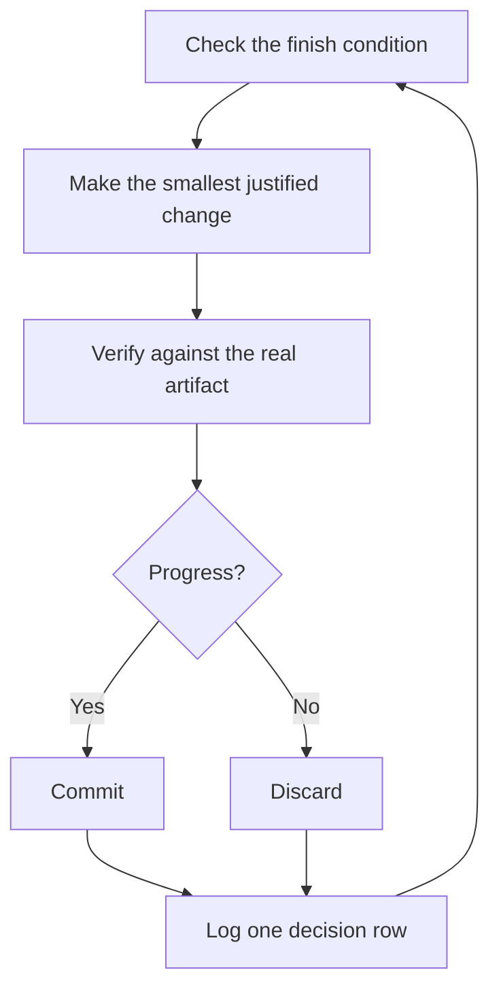

# Run work while you sleep

Before you leave Codex working unattended, give it a checkable finish condition, an isolated worktree, and a decision log you can review later. Then choose how the work continues. A goal, a watcher, and a scheduled task have different lifetimes.


## Choose how work continues

Use native `/goal` for ongoing work in the desktop app, interactive Codex CLI, or IDE extension. Goal mode keeps the outcome and completion criteria attached to the chat. Keep the workspace available and continue in the same chat to steer the work. See [Long-running work](https://learn.chatgpt.com/docs/long-running-work).

An active-session watcher waits for an event or checks a condition periodically. xstack's PR watcher is one example. A watcher or sleep does not schedule another turn after the session ends. When no persistent runner is available, have Codex record the remaining work and resume point before the session ends. The [runtime reference](../../src/skills/poteto-mode/references/host-runtime.md) defines these fallbacks.

For a later check, create a scheduled task that returns to the same chat. Create and manage it in ChatGPT web or the desktop app. CLI and IDE clients do not provide the Scheduled management interface. Local scheduled work needs the computer on, the desktop app running, and the project available. Web tasks use accessible uploads and connected tools, not a folder on your computer. See [Scheduled tasks](https://learn.chatgpt.com/docs/automations).

## Verify the workflow before leaving it unattended

Before you leave a run unattended, check these conditions:

- You've done the task once by hand, or watched an agent do it, so you know what good looks like.
- The agent has the tools and signals you'd use yourself: the verification skill, the profiler, the logs.
- Every stage proves its work and can stop when a check fails.
- You've read a few transcripts and turned the repeated failures into tools, skills, or checks.

Leave the run unattended only after all four hold. Until then, run it while you watch.

## The overnight contract

A good handoff has the goal, the finish condition, permissions, and a rule for handling blockers. Enter `/goal`, then use a goal like this:

```text
$poteto-mode im going to bed. migrate every caller to the new parser in a fresh worktree off <base>.
done means zero old callers, all parser fixtures pass, old api deleted.
keep a decision log. commit verified changes as you go.
keep going until the checks pass. if progress needs information or access you don't have, record the blocker and a resume note.
```

Walk through what each line buys you:

- "im going to bed" asks the agent to continue independently within your authorized scope.
- "done means..." turns the goal into checks every iteration can run.
- "fresh worktree off `<base>`" keeps the run from colliding with anything else you have open.
- "commit verified changes" authorizes checkpoints you can review.
- The blocker rule preserves the evidence and the next step when Codex cannot continue.

Goal mode keeps the existing sandbox and approval policy. It does not grant more access or make a local process survive a closed client or sleeping machine. Keep the local session available, or arrange scheduled follow-up in a supported client. The [Autonomous run playbook](../../src/skills/poteto-mode/playbooks/autonomous-run.md) rechecks the finish condition as the work progresses.

Because you'll review this work after stepping away, `$poteto-mode` routes it through [`$figure-it-out`](../../src/skills/figure-it-out/SKILL.md), which designs the run's phases before any code and wires in the decision log.

To stop a run on purpose, tell the agent to pause, or that you're about to go offline or restart Codex. The [Pause safely playbook](../../src/skills/poteto-mode/playbooks/pause-safely.md) finishes or backs out of the current step, commits a work-in-progress checkpoint, and writes a resume note. A fresh chat picks the work up from that note through the Session pickup playbook. Saying "keep going" never triggers a pause.

## What the run checks as it works



Each iteration makes one change, checks it, and records the decision. The agent discards a change that did not help and tries a different hypothesis. The finish condition stays fixed.

## Schedule a follow-up in the same chat

Use a scheduled task when work needs a later check, such as waiting for CI. In a supported web or desktop chat, select poteto-mode from the skill picker and ask:

```text
schedule a check every 30 minutes in this chat until this PR is merge-ready.
check CI and review feedback, address verified issues, and report blockers.
stop the scheduled checks once the PR is merge-ready. do not merge it.
```

A scheduled task inside a chat returns with that chat's context. A standalone task starts from its saved prompt and suits independent recurring work. Confirm that the task exists and targets the intended chat before leaving. Keep the finish condition and cancellation rule in the task prompt. See [Schedule a task inside a chat](https://learn.chatgpt.com/docs/automations#schedule-a-task-inside-a-chat).

## The morning audit

[`$show-me-your-work`](../../src/skills/show-me-your-work/SKILL.md) makes the run reviewable. Each row records the time, phase, decision, reason, an evidence pointer, and result. The TSV defaults to `.agents/state/xstack/<run-id>/decisions.tsv`, unless you choose another path. It stays local by default. Commit it when a reviewer needs the trail to trust the result.

When you're back, ask for the run in review form:

```text
$show-me-your-work catch me up on what you did last night
```

Before the skill hands back its summary, it asks an independent reviewer to read the trail and transcript. It uses a different model family when available and reports any fallback. The reply ends with an Attention section listing what deserves your scrutiny. Read that section first, then the log rows it points at. You're auditing decisions, not re-reading the whole night.

For a quick status instead of an audit, run [`$ketchup`](../../src/skills/ketchup/SKILL.md) in the chat that ran the work. It reads only, and tells you in plain words what changed since your last message, with the screenshots and small diagrams the work produced. Then it lists each call waiting on you, such as a merge, an approval, or a choice between options, with its pick, the evidence, and the risk, so you can decide from the reply alone.

## When the night holds a queue, not a task

The contract above drives one task to one finish condition. Some nights hold more: a queue of independent changes, or a whole program. Three playbooks handle that.

[Autopilot-full](../../src/skills/poteto-mode/playbooks/autopilot-full.md) runs a queue of independent PRs to merged. Each PR gets one owner agent that carries it from build through merge, and no owner merges on its own verdict. A swarm of fresh verifiers checks the owner's code-ready head. A later rebase or minor fix gets one fresh verifier, and only new behavior or a large new diff calls the full swarm again. Only a clean verdict on the patch that merges authorizes the merge:

```text
$poteto-mode full autopilot on this queue. each item is independent. i want them merged by morning.
```

[Autopilot-stack](../../src/skills/poteto-mode/playbooks/autopilot-stack.md) runs the same owner loop but ships nothing. You wake up to one linear base-branch stack with a verifier's verdict on every link, and you review and land it yourself. Pick it over Autopilot-full when the changes are coupled, or when you want your own eyes on the work before anything merges:

```text
$poteto-mode autopilot these five changes but stack them, don't ship. i'll land the stack in the morning.
```

[Orchestrate](../../src/skills/poteto-mode/playbooks/orchestrate.md) is for a program that outlives any single agent: multi-day, many stacked PRs, fleets of subagents under one standing coordinator chat. The coordinator authors briefs, collects what its subagents finish, keeps the lowest unmerged PR green, and never writes code itself. It costs more than the other playbooks, on purpose. If one agent could finish the work in a session, the playbook itself routes you back to the overnight contract above:

```text
$poteto-mode orchestrate the store migration. own it until every package is converted and merged. i'll check in twice a day.
```

## Run many projects in parallel

Give each standing body of work one coordinator session of its own. The coordinator doesn't write code. It directs subagents in isolated worktrees, or remote workers when the Codex session offers them. Confirm the remote runner's lifetime before relying on it after closing your laptop. Local work still needs its execution environment available. Start your prompts to the coordinator with `$poteto-mode`, and the subagents it spawns follow the playbooks.

A few habits help:

- Give each body of work its own coordinator session, such as a feature, a migration, a perf push, or a tech-debt cleanup. Several can run side by side, each in its own worktree.
- Point the coordinator at related sessions, finished ones included. `$recall` rebuilds their context from your chat history.
- Give each PR a verification swarm before it merges, and let Autopilot-stack or Autopilot-full carry the queue.
- Ask the coordinator for a plan backed by data, and have it answer open questions with prototypes before it asks you.

One prompt can carry a whole project, from research through execution:

```text
$poteto-mode refactor this repo so its architecture is more agent friendly. use $correct and $architect on past commits and review comments to find the mistakes agents make most here. use $recall for context from past chats. answer open questions with prototypes instead of asking me. come back with a plan backed by real data. once i approve it, run it with autopilot-stack or autopilot-full, and ask me which.
```

## Start from a schedule or event

A scheduled or event-driven automation can start a workflow without a new prompt from you. Software maintenance has distinct stages for this purpose. Triage the report, reproduce it, fix it, then verify the fix. Apply two rules:

- Every stage can stop the line. Triage can decide the report is expected behavior, repro can fail to reproduce it, and the fixer can judge the change too risky. Each of those outcomes is useful, because it keeps bad work from reaching the next stage, where it costs more to undo.
- Every stage hands over evidence. Repro attaches screenshots and video of the broken state, and the fix attaches before-and-after proof. A human can then check that the agent fixed the right thing before reading a line of code.

xstack ships this as a dormant [automation pack](../../automations/benny/README.md) for Slack issue reports. One automation triages each report. The other reproduces confirmed bugs and may prepare a small draft fix. Point an agent at its [`FOR_AGENTS.md`](../../automations/benny/FOR_AGENTS.md) and name the target repository to set it up.

**Pitfall.** A duration is not a finish condition. "work on this for 4 hours" gives Codex nothing to check. Give the goal a condition that can pass or fail, and keep it in every scheduled follow-up.

Next: [Steer with principle names](./08-principles.md).
